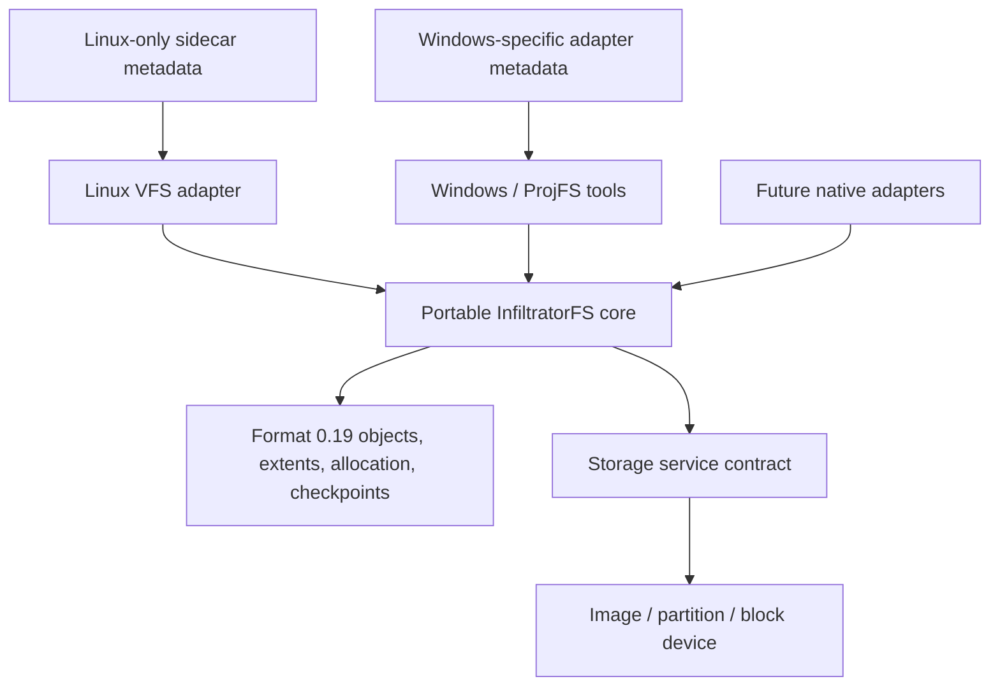
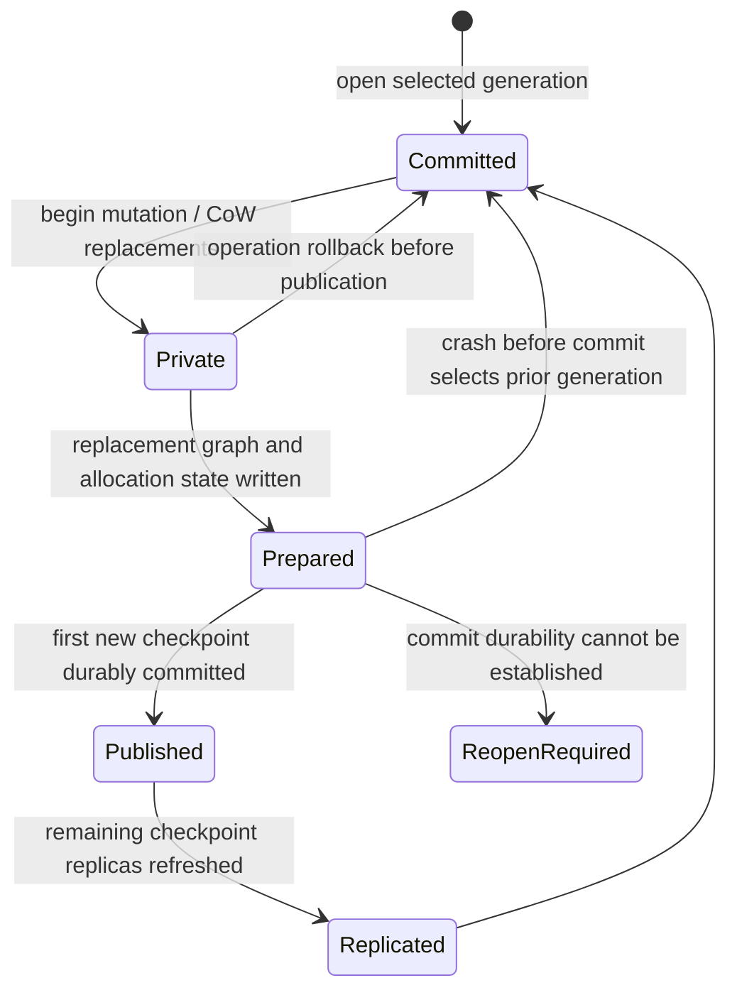
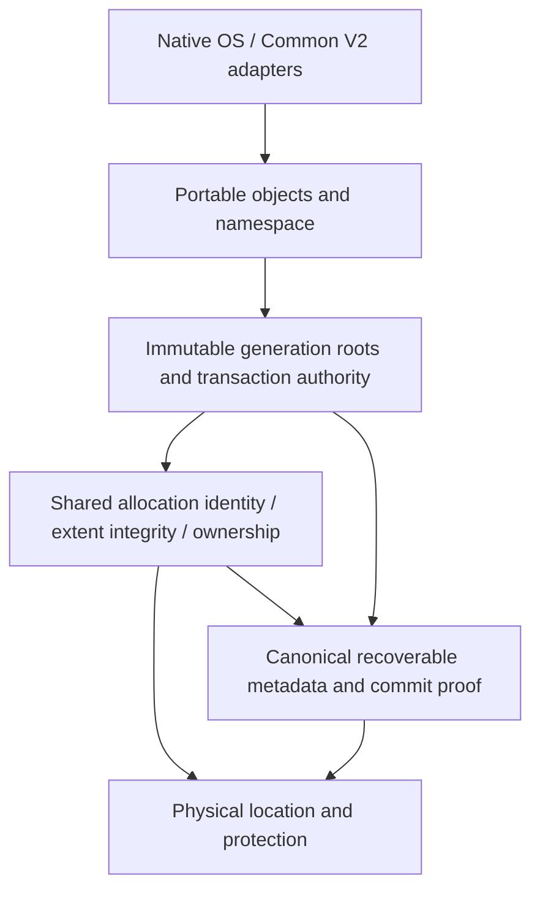

<!-- SPDX-License-Identifier: GPL-3.0-or-later -->
# InfiltratorFS Architecture

This document describes the architectural model and design invariants of InfiltratorFS. It deliberately does **not** track feature completion, workflow results or release history. Current completion belongs in `ROADMAP.md`; exact qualification evidence belongs in `QUALIFICATION.md`; persistent field/layout details belong in `ON_DISK_FORMAT.md`.

## 1. Architectural boundary

InfiltratorFS is defined by its persistent format and portable core, not by Linux VFS semantics or any other operating system.

The common layer owns:

- persistent filesystem and object identity;
- transactions and generations;
- checkpoints and recovery;
- allocation ownership;
- object, directory, extent, snapshot and integrity structures;
- portable attributes and extension points; and
- storage/durability/randomness/clock service contracts.

Operating-system adapters translate native APIs into that model. Equivalent concepts should map to one portable representation. Truly platform-specific semantics may be preserved in isolated adapter metadata rather than forcing every platform to imitate them.



The diagram is an ownership map, not a call graph: persistent meaning flows
through the portable core, while adapters own native API, cache, security and
lifetime semantics.


## 2. Persistent identity and namespace

Filesystem and object identities are 128-bit persistent values. Paths are namespace mappings, not object identity.

Directories map UTF-8 names to persistent objects. Regular files may have multiple namespace references through hard links. Symbolic links are their own persistent objects with stored targets. Namespace operations are transactional and must preserve exact parent/reference/link-count invariants.

Format 0.19 uses 1023-byte UTF-8 component names and explicit validation of forbidden traversal/reserved forms. Unicode-name policy v1 performs no implicit normalization and preserves valid UTF-8 exactly. The default namespace remains byte-exact and case-sensitive. An optional incompatible case-fold policy v1 canonicalizes ASCII A-Z to a-z for lookup identity while retaining original spelling and treating every non-ASCII UTF-8 byte exactly; portable and native directory caches/tree routing use that same rule. Any broader normalization or Unicode case-folding semantics require a new versioned policy rather than silently changing current lookup behavior. The byte-level v1 ASCII fold and removable-name admission rules have one implementation in `include/infilfs/namespace_policy.h`, compiled into both the portable core and native Linux adapter. UTF-8 validation and VFS dentry integration remain caller-owned.

## 3. Transactions, generations and checkpoints

Mutation is copy-on-write and generation based. A transaction constructs replacement state and publishes it through a new committed checkpoint generation.

Three physically separated checkpoints provide independent recovery candidates. Their committed locations are part of filesystem geometry; they are not blindly recomputed from current backing-device size.

The commit boundary is fail-closed:

1. replacement data/metadata and allocation state are written;
2. required durability operations complete;
3. the first new checkpoint is durably published, making the new generation authoritative;
4. each remaining checkpoint replica is written and durably flushed separately.

Fixed recovery locators at blocks 1 and 2047 independently describe checkpoint geometry. Ordinary commits never rewrite them. Resize first flushes replacement dependencies, then locator A, then each new checkpoint individually, then locator B. The shared protocol lives in `include/infilfs/checkpoint_protocol.h`; both portable and native writers use it. Writable open repairs checkpoint copies before obsolete locator hints, preserving valid survivors throughout.

If durability of the first publication cannot be established, further mutation must not continue as though the transaction definitely committed.



The important distinction is between *prepared* state and a durably published
checkpoint. Replacement blocks alone do not make a generation authoritative.

Recovery selects the newest complete structurally valid committed graph. Structural corruption can justify fallback to an older committed generation; unrelated I/O, unsupported-format or resource failures must not be misclassified as corruption.

Operation-level savepoints allow one failed operation to roll back its own tentative changes without discarding earlier acknowledged buffered work.

## 4. Allocation model

Allocation ownership is logically a one-bit-per-block model, persisted through a sharded copy-on-write allocation tree rather than a monolithic bitmap image. Runtime free-extent indexes are derived accelerators and can be rebuilt from authoritative allocation state.

This preserves the simplicity of bitmap ownership while allowing scalable publication: only affected allocation leaves and their replacement branch paths need to be rewritten.

Linux additionally uses volatile sharded reservation state so independent writers can search and reserve candidate data runs before the serialized metadata transaction. Reservation state is never authoritative persistent allocation.

Placement policy is deliberately volatile where possible. Sequential, random/in-place and sparse workloads may select different free runs; rotational and non-rotational media may score those runs differently. These choices must not redefine persistent object identity or Format 0.19 semantics.

Unsupported zoned-device write-pointer semantics are rejected rather than approximated unsafely.

### Per-object protection and encryption policy

Format 0.19 reserves disjoint high bits in the common object attributes word for
a persistent protection-copy count and encryption-domain ID. The ordinary
portable presentation flags occupy separate low bits.

Policy-aware file-data I/O carries the owning object's stable 128-bit identity,
requested replica count and encryption-domain ID into the storage stack.
Replicated storage deterministically maps the object identity onto the requested
number of healthy mirror members; encrypted storage derives a domain-specific
AEAD subkey for nonzero domains. Metadata/checkpoint I/O intentionally remains
on the backend default policy so object policy can always be discovered before
object data is read.

Nondefault policy data is never stored inline in metadata. Named streams inherit
their owner's policy class. A nonempty file cannot switch policy by changing
metadata alone because doing so would strand existing extents under the old
placement/key; such changes fail closed until a relocation operation is
performed.

## 5. File data and extents

Regular files may be empty, inline, extent-backed, sparse or reflinked.

Allocated file ranges are represented by extents; holes represent logical zero ranges without owning physical data blocks. Highly fragmented files may use paged extent metadata.

Shared extents implement reflinks. Mutation of shared data follows copy-on-write rules so one logical file update cannot modify another file or retained generation that still references the old physical data.

Logical file integrity is SHA-256 protected. Metadata structures are CRC64-ECMA protected.

## 6. Compression

Compression is per extent and bounded. The default native codec is IAC1 v1. Compression is selected only when it saves filesystem blocks; incompressible data falls back to ordinary extents rather than paying permanent expansion cost.

Compressed data remains ordinary logical file data from the namespace/API perspective. Partial mutation, truncate, hole punching, page-cache reads and defragmentation must preserve logical contents and integrity regardless of physical compressed representation.

The detailed codec/extent contract lives in `COMPRESSION.md`.

## 7. Snapshots and retained generations

Named snapshots identify immutable earlier generations. Blocks referenced by any retained generation remain unavailable for reuse until no live or retained graph references them.

Snapshot semantics are a consequence of the common generation/CoW model rather than a separate storage mechanism.

Whole-volume snapshot rollback reuses that retained-generation model directly: the selected retained roots are republished as a fresh monotonically increasing live generation instead of copying the historical namespace into a new backup structure. Selected-object restore can also materialize one retained file, directory subtree or symbolic link back into the live namespace without rolling back unrelated objects, while preserving portable metadata/security and named streams.

Current geometry-change design is conservative: resize may reject retained snapshots instead of attempting snapshot-aware geometry migration.

## 8. Integrity, scrub and forensics

Normal reads validate the integrity metadata required for the objects/data they consume. Full scrub validates the reachable live graph plus retained snapshot state, including ownership and namespace invariants.

Metadata graphs must reject cycles or multiply aliased metadata pages where the format requires a tree. Traversal algorithms must be bounded in memory/stack behaviour and must fail closed on malformed topology.

The forensic scanner is deliberately separate from authoritative recovery. It can discover independently recognizable authenticated metadata from physical media, but discovery alone does not make a structure the committed filesystem state. See `FORENSICS.md`.

### Accidental-format resilience (first-class design requirement)

Accidental formatting, including by a foreign filesystem, is a distinct failure class from interrupted transactions and ordinary deletion. InfiltratorFS must be designed to maximise recovery of a coherent previous filesystem identity, namespace and contents where physical evidence survives. This is a new architectural requirement, not an obligation to preserve the current implementation. Pre-1.0 development may replace Format 0.19, change checkpoint/locator layouts, allocation structures, encryption headers or recovery algorithms, and redesign the forensic tooling where justified. Existing mechanisms are candidates, not constraints. Select the design based on measured survival, integrity, overhead and recovery fidelity rather than compatibility with a superseded development format.

- Prevent accidental destructive formatting through common target-bound preflight and explicit authorisation across all formatter entry points; refuse busy, mounted or ambiguous targets by default.
- Design a recoverable native quick format with a new volume identity, a validated retained prior graph and protection of its reachable data against allocation, relocation and discard until explicit release. Refuse the operation if safe retention or adequate space cannot be established. It is not secure erase.
- Design distributed independently discoverable recovery anchors and redundant essential graph metadata across distinct overwrite/failure regions. Evaluate placement against real foreign formatter write patterns; account for reserved space, resize, transactional publication, generation/volume identity and write amplification. No fixed anchor count, location, metadata encoding or retention mechanism is mandated by this requirement.
- Provide independent offline reconstruction even after loss of partition tables and primary filesystem structures. Validate coherent graphs, ownership, bounds, generation and data integrity; distinguish complete, partial and ambiguous recoveries. Default to exporting to separate storage, not modifying the source.

Foreign formatting is outside our control. Overwrite, discard/TRIM, secure erase, physical failure or loss of usable encryption keys can make recovery impossible. This feature is not a backup substitute. Persistent layout changes require a versioned design decision and qualification; this requirement is not a claim of existing implementation. See `FORENSICS.md`, `SECURITY.md` and `ROADMAP.md`.

## 9. Administration

Online resize separates committed filesystem geometry from physical backing capacity. Grow/shrink rebuilds required allocation geometry transactionally, preserves or relocates checkpoint positions as required and refuses shrink that would discard live allocation.

Online defragmentation is copy-on-write. It may improve physical layout but must preserve object identity, logical content, hard-link identity, xattrs and user-visible timestamps while respecting snapshot/reflink retention.

Quota accounting is an adapter-level administrative policy over persistent objects rather than part of portable object identity. Linux quota state may persist rules/roots and rebuild usage from authoritative namespace/object state. Whether a quota implementation is currently complete belongs in `ROADMAP.md`, not here.

The repair-capable fsck distinguishes deterministic repairs from cases where correctness cannot be established. It may reconstruct damaged checkpoint replicas only from a surviving validated committed graph; ambiguous authoritative metadata corruption remains fail-closed and unmodified.

## 10. Linux adapter

Linux uses the native out-of-tree `infiltratorfs.ko` VFS driver. The current architecture has no userspace FUSE fallback.

The adapter maps VFS inodes/dentries/page-cache operations onto persistent InfiltratorFS objects and transactions. Linux-only metadata such as POSIX ownership/mode, xattr namespaces and special-node details is isolated from the portable object model so it does not become the permanent cross-platform security definition.

The standard `mount.infiltratorfs` helper and InfiltratorFS Manager both request native `infiltratorfs` mounts. Packaging uses DKMS so the module is built against installed host kernel headers.

Kernel locking and transaction ownership must remain explicit. As the driver grows, lock-order and deferred-publication rules should be centralized rather than inferred from scattered call paths.

### Linux CPU-parallelism invariant

The native Linux filesystem has a fixed filesystem-wide CPU-heavy concurrency policy:

```text
filesystem_cpu_budget = max(1, online_physical_cores - 1)
```

One complete physical core worth of CPU-heavy filesystem concurrency is
deliberately left outside the InfiltratorFS worker budget for the rest of the
operating system whenever more than one physical core is online. SMT siblings
remain scheduler capacity, but they do not increase the filesystem worker
budget. A one-core machine necessarily gives InfiltratorFS that one core.

Examples are normative:

```text
1 online physical core                 -> filesystem budget 1
2 online physical cores                -> filesystem budget 1
3 online physical cores                -> filesystem budget 2
12 physical cores / 14 logical CPUs    -> filesystem budget 11
255 online physical cores              -> filesystem budget 254
```

This is a concurrency-budget rule, not CPU pinning: Linux remains free to
schedule work on any online logical CPU. When enough independent filesystem
work exists and CPU is the limiting resource, the implementation must be
capable of using the full physical-core-derived budget. Actual utilisation may
be lower when there is insufficient independent work or when storage, memory
bandwidth, memory pressure, durability or another resource is the real
bottleneck. No fixed small worker count may replace or silently cap this N-1
physical-core policy.

Independent data preparation, compression, integrity hashing, allocation
search/reservation, CoW branch construction, writeback and metadata preparation
must be able to proceed concurrently up to this budget where their dependencies
permit. A mount-wide/global lock must not turn those stages into a single-writer
pipeline. Global serialization is reserved for the shortest correctness-critical
coordination needed to atomically publish authoritative transaction/checkpoint
state; expensive preparation work must occur outside that publication critical
section.


## 11. Windows adapter

Windows has portable-core image/raw-device access, the driverless ProjFS Explorer bridge, and a native filesystem-driver implementation. The bridge remains the no-kernel-driver interoperability/recovery path.

The native adapter registers as a disk filesystem and owns Windows I/O Manager and Cache Manager integration, native mount/VPB lifetime, shared FCB/CCB state, cached/non-cached/paging I/O, share/delete semantics, byte-range locks, oplocks, security dispatch, namespace mutation and shutdown durability while delegating persistent namespace/data semantics to the same portable core through the native service protocol. It is implementation-complete in source but is not release-qualified until a real Windows mount completes the mounted/Driver-Verifier qualification recorded in ROADMAP.md and QUALIFICATION.md.

## 12. Security model

Current POSIX compatibility fields and Linux xattr sidecars are not the portable security authority.

Format 0.19 implements versioned portable security objects, stable typed principals, portable rights and explicit Linux/Windows mapping. Platform-specific security metadata remains preservable even when another adapter cannot interpret it. See `SECURITY.md`.

## 13. Design guardrails

- Persistent format semantics must not depend on one operating system's API names.
- Runtime policy should remain replaceable and non-persistent unless persistence is required for correctness.
- The single-device filesystem must remain complete and understandable without multi-device features.
- New persistent hard limits require explicit rationale and scale analysis.
- Compression, encryption, protection classes, replication, case-folding and named streams should build on existing primitives instead of creating parallel incompatible models.
- Fail closed when integrity, durability or recovery correctness cannot be established.

For field-level Format 0.19 details, use `ON_DISK_FORMAT.md`. For what is finished, use `ROADMAP.md`. For proof, use `QUALIFICATION.md`.

---

## Proposed Format 0.20 — unified design (revisions 3–4)

**Proposal only; the preceding current-format contract remains applicable to Format 0.19.** The [unified Format 0.20 specification](ON_DISK_FORMAT.md#proposed-infiltratorfs-on-disk-format-020) is the design authority for the proposed persistent model. This section specialises that model; it does not introduce a second on-disk authority or claim implementation.

The proposed architecture is a single coordinated storage engine. Its six responsibilities are not independent subsystems with independent transaction or allocation state.



- **Objects:** one keyed portable semantic record model for files, directories, attributes, streams, ACLs and quota policies. Indexes are rebuildable; identities, relationships and content mappings are not inferred from paths.
- **Generations:** one monotonic set sequence; active, snapshot and retired volume roots share immutable subtrees. Rollback and native unformat select roots; reflink shares allocations.
- **Ownership:** direct strong edges and persistent reference accounting, independently traced during scrub; one deferred release queue for payload, security, extensions and metadata. Explicit bootstrap arena for self-hosting roots, not an unrelated allocator.
- **Extents:** allocation identity independent of physical location and referencing file. Logical SHA-256 and codec/protection descriptor are shared; location updates support defrag, resize and repair across retained roots. Policy-compatible sharing only.
- **Recovery:** the canonical metadata itself is independently replicated/discoverable. Semantic and location commitments identify the same committed state; normal lookup trees and caches can be reconstructed. Native format pins old roots; foreign-format recovery discovers surviving committed records. No second backup namespace.
- **Storage:** region-aware placement, encryption and member replication operate through the common allocation/location model; selected recovery profile is mandatory. Physical durability remains a prerequisite to publication.

Keep fast bounded mount, ordinary structural fsck, deep scrub and offline reconstruction distinct in cost and authority. NoCoW cannot overwrite a retained dependency or separate a data mutation from integrity/commit authority; CoW is the safe default. Preserve the native N-1 physical-core CPU budget and demand-paged caches. Historical 0.19 architecture remains above until implementation changes; the proposal supersedes only future design decisions.

### Revision 4 engineering refinement
The detailed candidate wire contract and dependency gates are in ON_DISK_FORMAT.md sections 20.13–20.20. Ordinary immutable authenticated tree pages supply membership proof; do not maintain a second canonical namespace or claim exact committed membership when every copy of a required proof node is lost. Stable allocation IDs decouple data location from semantic roots, not necessarily metadata page relocation. Direct strong lifetime edges and non-owning registry indexes are distinct. The self-hosting candidate is a reserved append-allocated CoW segment arena; publication, reader pins, fallback and release are one state machine. Until integrated NoCoW data+digest atomicity is qualified, committed writes remain CoW.
